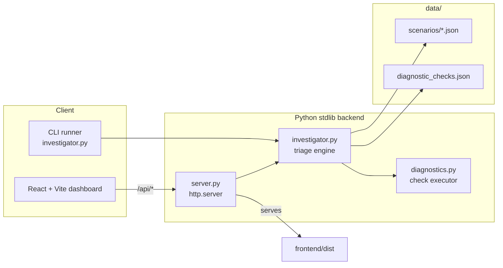
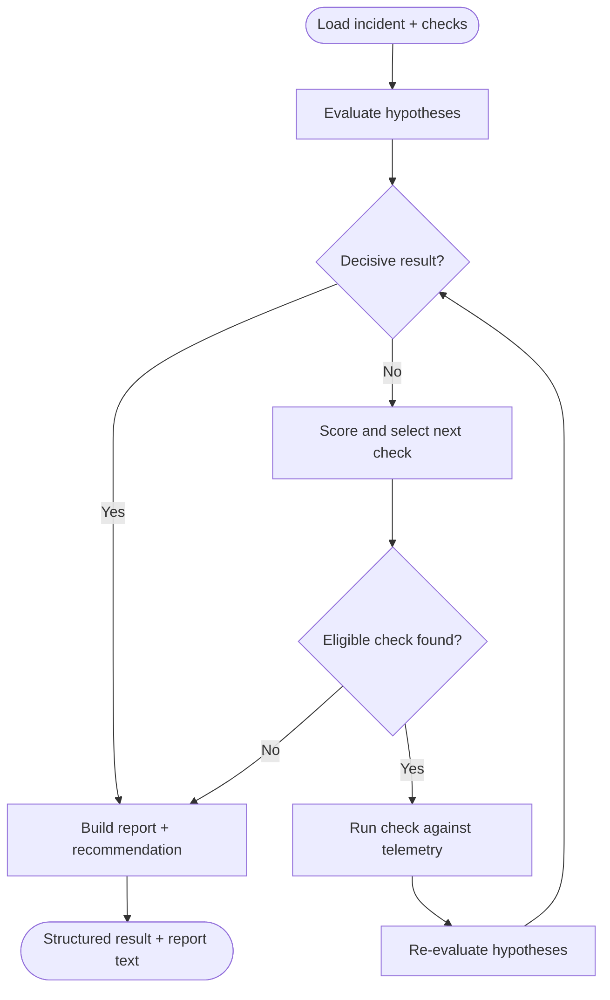

<div align="center">

# Tracer

### Autonomous Incident Investigation and Root Cause Analysis Engine

Tracer triages system incidents and autonomously isolates root causes by selecting and running diagnostic probes to test competing hypotheses, with transparent scoring and no reliance on ground truth at runtime.

[](https://www.python.org/)
[](https://react.dev/)
[](https://vite.dev/)
[](https://docs.python.org/3/library/http.server.html)
[](https://www.docker.com/)

</div>

---

## Overview

Tracer investigates an incident from an initial set of observations (logs, metrics, alerts) and a set of candidate hypotheses. It runs a triage loop that:

1. Evaluates hypotheses against initial observations and collected probe evidence.
2. Scores and selects the diagnostic probe that best disambiguates unresolved or competing hypotheses.
3. Executes the probe against telemetry and re-evaluates every hypothesis.
4. Stops when a decisive root cause is isolated, or reports an incomplete, ambiguous, or inconclusive outcome honestly.
5. Emits a recommended remediation action tagged with a safety tier.

The engine is ground truth blind: `ground_truth` fields in scenario files are used only for offline testing and are never read during investigation or exposed through the API.

## Features

All features below are backed by the code in `backend/` and verified by the test suite in `tests/`.

- **Heuristic probe selection** — each step scores candidate checks as `unresolved * 2 + supported * 1` and records a `"Why this check?"` reason (`choose_next_check`).
- **Hypothesis evaluation** — hypotheses resolve to `supported`, `contradicted`, `mixed`, or `unresolved` from combined initial observations and probe results (`evaluate_hypotheses`).
- **Honest termination** — the loop distinguishes decisive, incomplete-triage, ambiguous, and inconclusive outcomes rather than forcing a single answer (`has_decisive_result`, `build_report`).
- **Remediation safety tiers** — recommended actions are classified `SAFE_READ_ONLY` or `OPERATOR_REVIEW_REQUIRED` based on disruptive keywords (`classify_action_safety`).
- **Evidence tagging** — findings are labelled `[INITIAL OBSERVATION]` or `[SIMULATED PROBE]` to keep evidence sources explicit.
- **Ground truth protection** — the REST API redacts `ground_truth` from every scenario response (`/api/scenarios`, `/api/scenarios/{id}`).
- **Two interfaces** — a CLI runner with scenario switching and a React dashboard served by the same backend.
- **Zero backend dependencies** — the API and static server run on the Python standard library (`http.server`).

## Tech Stack

| Layer | Technology |
|-------|------------|
| Backend engine and API | Python 3 standard library (`http.server`, `json`, `argparse`, `pathlib`, `unittest`) |
| Frontend | React 18, Vite 6 |
| Icons | lucide-react |
| Container | Docker multi-stage build (`node:22-alpine`, `python:3.12-slim`) |

## Architecture



### Investigation loop



## Project Structure

```
.
├── backend/
│   ├── diagnostics.py          # Diagnostic check executor and result validation
│   ├── investigator.py         # Triage loop, scoring, evaluation, report, CLI
│   └── server.py               # REST API and static frontend server
├── data/
│   ├── diagnostic_checks.json  # Diagnostic check catalog and causal effects
│   ├── incident.json           # Default incident scenario
│   └── scenarios/              # Incident scenarios INC-001 through INC-004
├── frontend/
│   ├── src/                    # React dashboard (App.jsx, main.jsx, index.css)
│   ├── index.html
│   ├── package.json
│   └── vite.config.js
├── tests/                      # unittest suites for engine, scenarios, and API
├── Dockerfile
└── README.md
```

## Prerequisites

- Python 3.12 (3.x with standard library is sufficient to run the backend and tests)
- Node.js 22 and npm (only for building or developing the frontend)
- Docker (optional, for containerized builds)

## Installation

The backend has no pip dependencies. Clone the repository and run it directly.

```bash
git clone <repository-url>
cd TRACE-2.0
```

Install frontend dependencies only if you plan to build or develop the dashboard:

```bash
cd frontend
npm ci
```

## Environment Variables

| Variable | Used by | Default | Description |
|----------|---------|---------|-------------|
| `PORT` | `Dockerfile` CMD | `10000` | Port the container binds to at runtime. Injected by the hosting platform. |

The backend itself takes no environment variables. When run directly it is configured with `--host` and `--port` flags.

## Development Commands

### CLI

```bash
# Run the default incident investigation
python backend/investigator.py

# List all available scenarios
python backend/investigator.py --list-scenarios

# Run a specific scenario by incident id
python backend/investigator.py --scenario INC-002

# Use a custom checks catalog
python backend/investigator.py --scenario INC-003 --checks data/diagnostic_checks.json
```

Module form is also supported:

```bash
python -m backend.investigator --scenario INC-001
```

### API server and dashboard

Build the frontend once, then start the backend to serve the API and the built dashboard from the same port:

```bash
cd frontend && npm run build && cd ..
python backend/server.py --port 8000
```

Open http://localhost:8000/

### Frontend development with hot reload

Run the API and the Vite dev server in two terminals. The dev server proxies `/api` to the backend.

```bash
# Terminal 1
python backend/server.py --port 8000

# Terminal 2
cd frontend
npm run dev
```

Open http://localhost:5173/

### Tests

```bash
python -m unittest discover tests
```

## API Reference

| Method | Endpoint | Description |
|--------|----------|-------------|
| `GET` | `/api/health` | Engine health and version. |
| `GET` | `/api/scenarios` | List scenarios (ground truth redacted). |
| `GET` | `/api/scenarios/{id}` | Fetch one scenario by id (ground truth redacted). |
| `GET` | `/api/checks` | Diagnostic check catalog. |
| `POST` | `/api/investigate` | Run an investigation. Body: `{ "scenario_id": "INC-002" }` or `{ "scenario_path": "..." }`. |

```bash
# Health check
curl http://localhost:8000/api/health

# Run an investigation
curl -X POST http://localhost:8000/api/investigate \
  -H "Content-Type: application/json" \
  -d '{"scenario_id": "INC-002"}'
```

## Evidence Model

Tracer keeps evidence sources explicit so results are auditable:

- `[INITIAL OBSERVATION]` — context gathered when the incident opened, such as deployment timestamps and application logs.
- `[SIMULATED PROBE]` — diagnostic checks executed against the scenario's telemetry fixtures.

`ground_truth` fields exist in scenario files only for offline evaluation. The engine never reads them when selecting checks, updating hypothesis status, deciding termination, or generating recommendations, and the API redacts them from all responses.

## Deployment

The `Dockerfile` is a two-stage build: stage one builds the frontend with `node:22-alpine`, stage two copies the built assets into a `python:3.12-slim` image that runs the backend.

```bash
docker build -t tracer .
docker run -p 10000:10000 tracer
```

The container binds to `0.0.0.0` and reads `$PORT` at runtime, falling back to `10000`. Platforms that inject `$PORT` (such as Render) are supported without changes. Open http://localhost:10000/ when running locally.
